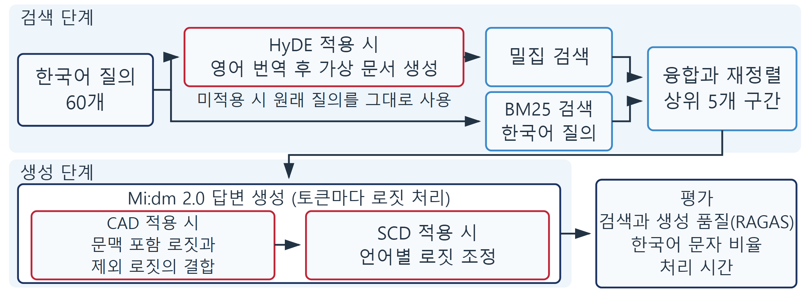
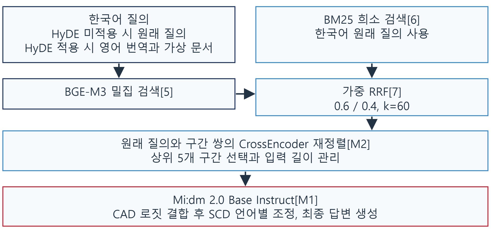

# Cube-RAG

**한국어 질의 기반 영문 문서 검색 증강 생성(RAG)의 성능 개선 알고리즘 비교 분석**
*Comparative Analysis of Performance Improvement Algorithms for RAG on English Documents with Korean Queries*

동국대학교 WISE캠퍼스 컴퓨터공학과 졸업자격실험보고서 (2026년 11월 제출)

| 졸업자격실험보고서 | A1 포스터 | 제출 패키지 | 포트폴리오 |
|---|---|---|---|
| [PDF](FINALDOCS/DELIVERY/GRADUATION_REPORT_60Q_FINAL.pdf) · [원고](FINALDOCS/MANUSCRIPT/GRADUATION_REPORT_TRANSFER_KO_60Q.md) | [인쇄 PDF](FINALDOCS/POSTER/FINAL/M_RAG_A1_FINAL_PRINT.pdf) | [FINALDOCS](FINALDOCS/README.md) | [lxnx-hn.github.io](https://lxnx-hn.github.io/#project-cube-rag) |

## 한눈에 보기

한국어 질문으로 영어 학술·기술 문서를 검색해 한국어로 답하는 RAG는 세 가지를 함께 풀어야 합니다.
한국어 질의와 영어 원문 사이의 어휘 차이를 넘어 근거를 찾고(검색), 영어 근거를 답변에 충실히
옮기고(근거 반영), 모델이 영어 근거를 따라 영어로 답하는 언어 이탈을 막아야 합니다(출력 언어).

이 프로젝트는 세 과제에 하나씩 대응하는 기법을 같은 파이프라인에서 비교합니다.

| 기법 | 단계 | 역할 |
|---|---|---|
| **HyDE** (Hypothetical Document Embeddings) | 검색 | 질의를 영어 가상 문서로 바꿔 밀집 검색 입력으로 사용 |
| **CAD** (Context-Aware Decoding) | 생성 | 검색 문맥 포함·제외 로짓을 대조해 근거가 뒷받침하는 토큰을 선호 |
| **SCD** (Soft Constrained Decoding) | 생성 | 목표 언어(한국어) 토큰과 다른 언어 토큰의 로짓 배율을 달리해 출력 언어 제어 |

고정 Paper-RAG 파이프라인에서 세 기법의 적용 여부를 조합한 **8개 조건**을 **한국어 질문 60개**에 적용해
**480개 답변**을 생성·평가했고, 질문을 수치형(18)·방법형(25)·개념과 결과형(17)으로 나눠 다시 비교했습니다.



## 주요 결과

질문 60개에 대한 8개 조건의 평균입니다. 표준편차를 포함한 전체 표는 [원고 표 5-1](FINALDOCS/MANUSCRIPT/GRADUATION_REPORT_TRANSFER_KO_60Q.md)에 있습니다.

| 조건 | 근거 충실도 | 답변 관련성 | 문맥 정밀도 | 문맥 재현율 | 한국어 문자 비율 | 처리 시간(초) |
|---|---|---|---|---|---|---|
| 1 미적용 | 0.791 | 0.683 | 0.749 | 0.933 | 0.494 | 16.7 |
| 2 HyDE | 0.834 | **0.763** | 0.714 | 0.933 | 0.556 | 23.5 |
| 3 CAD | 0.839 | 0.675 | 0.740 | 0.917 | 0.488 | 64.2 |
| 4 SCD | 0.787 | 0.637 | **0.763** | 0.900 | 0.699 | 18.7 |
| 5 HyDE+CAD | **0.860** | 0.705 | 0.736 | 0.900 | 0.503 | 72.5 |
| 6 HyDE+SCD | 0.822 | 0.710 | 0.743 | 0.900 | **0.807** | 24.8 |
| 7 CAD+SCD | 0.777 | 0.600 | 0.752 | 0.850 | 0.719 | 56.0 |
| 8 HyDE+CAD+SCD | 0.831 | 0.667 | 0.754 | 0.917 | 0.731 | 65.8 |

- **HyDE**는 답변 관련성을 0.683에서 0.763으로 높였고, 효과는 방법형 질문에서 가장 컸습니다(0.575 → 0.745).
- **CAD**는 근거 충실도를 0.810에서 0.839로 높였지만(값이 있는 58문항) 처리 시간이 약 세 배였고,
  개념과 결과형 질문에서는 답변 관련성을 0.778에서 0.663으로 낮췄습니다.
- **SCD**를 적용한 네 조건의 한국어 문자 비율(0.699–0.807)은 미적용 네 조건(0.488–0.556)보다 모두 높았습니다.
- 두 기법 이상을 조합한 네 조건의 답변 관련성은 모두 HyDE 단독보다 낮았습니다.

질문 유형별 선택 기준: 답변 관련성을 우선하면 **HyDE**, 한국어 답변이 필요하면 **HyDE+SCD**,
수치형 질문의 근거 충실도를 처리 시간보다 우선하면 **HyDE+CAD(+SCD)**.

근거 충실도, 문맥 정밀도, 문맥 재현율은 조건 1·2·3·5를 영어 검색 결과로, 조건 4·6·7·8을 한국어 번역
검색 결과로 평가했으므로 같은 평가 언어의 조건끼리 비교합니다. 처리 시간은 각 생성 실행의 첫 기록을 뺀
58개 질문으로 계산했습니다.

## 파이프라인



| 단계 | 모델 또는 방법 | 설정 |
|---|---|---|
| 밀집 검색 | BAAI/bge-m3 | 후보 8개, 가중치 0.6 |
| 희소 검색 | BM25 (한국어 원래 질의) | 후보 8개, 가중치 0.4 |
| 순위 융합 | 가중 RRF | k = 60 |
| 재정렬 | cross-encoder/ms-marco-MiniLM-L-6-v2 | 최종 구간 5개 |
| 답변 생성 | K-intelligence/Midm-2.0-Base-Instruct | greedy, 최대 512토큰, A100 80GB |
| HyDE | 영어 번역과 가상 문서 생성 | temperature 0.1, top_p 0.9 |
| CAD | 문맥 포함·제외 로짓 결합 | α = 0.5 고정 |
| SCD | 목표 언어 토큰 로짓 조정 (reference_scd) | α = 1.1, β = 0.9, T_start = 5 |
| 평가 | RAGAS 0.2.15 네 지표 + 한국어 문자 비율 + 처리 시간 | judge GPT-4o, 임베딩 BGE-M3 |

검색·재정렬 설정은 평가 질문과 분리한 튜닝 질문에서만 정했고, 본 실험에서는 세 기법의 적용 여부만 바꿨습니다.
검색 대상은 RAG Survey, CAD, RAPTOR, Mi:dm K 2.5 Pro Technical Report의 영어 문서 네 종이며 문서마다 질문 15개씩입니다.

## 8개 조건

| # | Config | HyDE | CAD | SCD |
|---|---|---|---|---|
| 1 | `hyde_off__no_decoder_control` | | | |
| 2 | `hyde_on__no_decoder_control` | ✓ | | |
| 3 | `hyde_off__cad_only` | | ✓ | |
| 4 | `hyde_off__scd_only` | | | ✓ |
| 5 | `hyde_on__cad_only` | ✓ | ✓ | |
| 6 | `hyde_on__scd_only` | ✓ | | ✓ |
| 7 | `hyde_off__cad_scd` | | ✓ | ✓ |
| 8 | `hyde_on__cad_scd` | ✓ | ✓ | ✓ |

Parameter freeze rule:

- Tune only on `tuning_queries`.
- Freeze `top_k`, `rerank_top_n`, `cad_alpha`, `scd_beta`, HyDE prompt/template, and generation settings before the main matrix.
- Do not tune on main, query-type analysis, or final-eval candidate queries.
- Result values come only from the scored artifacts under `experiments/results/`.

## 진행하며 해결한 문제

- **SCD 구현과 방법 효과 분리**: 초기 `penalty_additive` SCD가 한국어 유지에 거의 효과가 없어 원 논문과
  대조한 결과 target-language boost와 warm-up이 빠져 있었습니다. 기존 구현을 보존한 채 `reference_scd`를
  별도 mode로 구현해 다시 생성·평가했습니다
  ([report](experiments/reports/reference_scd_rerun_report_KO.md)).
- **Cross-lingual 평가 조건**: SCD 답변은 한국어, 검색 문맥은 영어라 RAGAS 점수에 언어 차이가 섞였습니다.
  검색 문맥이 같은 SCD on/off 쌍으로 영어·한국어 대칭 패널을 만들고 번역 전후 숫자·인용 보존을 검사했습니다
  ([symmetric eval](experiments/reports/reference_scd_symmetric_eval_report.md)).
- **Judge 의존성**: 같은 평가 입력을 다른 고정 judge로 다시 채점해 한 judge에서만 나타나는 차이를 결론에서
  분리했습니다 ([cross-judge](experiments/reports/reference_scd_symmetric_cross_judge_report.md)).
- **평균 아래의 원인**: 점수가 크게 바뀐 질문은 실제 검색 근거와 답변을 미적용 결과와 대조해 부록 B의 사례
  9개로 정리했습니다.

## Repository Layout

Four responsibility boundaries are intentionally kept separate — the ops runtime
does **not** import experiment code, and the evidence CLI reads stored artifacts
without importing either runtime (see `docs/REPO_LAYOUT.md`):

| Layer | Location | Role |
|---|---|---|
| Thesis package | `FINALDOCS/` | 60-question Korean manuscript, HWPX/PDF, poster, tables, figures, validation |
| Ops | `backend/`, `frontend/` | FastAPI + React paper-review service |
| Experiment | `experiments/` | fixed backbone, 8-config matrix, runners, RAGAS evaluator, analyzers, reports |
| Docs | `docs/` | architecture, paper, usage, explainers |
| Evidence CLI | `cli/` | offline, read-only replay of final thesis evidence |

## Reproducing the Experiment

The scored artifacts are checked in under `experiments/results/`. To reproduce:

1. Freeze: score tuning outputs with `experiments/evaluators/official_ragas_runner.py`
   (OpenAI-compatible judge endpoint; the final 60-question scores use GPT-4o), then
   `experiments/runners/prepare_parameter_freeze.py` writes `experiments/configs/frozen_params.yaml`.
2. Generate (GPU): `experiments/runners/run_generation.py --execute` with
   `CONFIRM_MAIN_8CONFIG_GENERATION=1` (Mi:dm 2.0 Base, A100 80GB recommended).
3. Score + aggregate: `official_ragas_runner.py` then `experiments/analyzers/aggregate_main_scores.py`
   and `scd_language_adherence.py`.

Evaluation runs on CPU + the judge API; only generation needs the GPU. The judge
is used **only for scoring** — generation is always local Mi:dm Base.

## Service Features

The FastAPI + React application is a graduation-project service integration layer.
Its A-F paper-review routes are preserved but are not the core thesis algorithm:

- A: simple QA.
- B: section-focused QA.
- C: document comparison.
- D: citation / patent-oriented lookup.
- E: structured summary.
- F: quiz / flashcard generation.

The thesis reports global and question-type HyDE/CAD/SCD comparisons; per-route
policy in the service is not claimed as validated by the thesis.

## Quick Setup

Backend:

```powershell
git clone https://github.com/LxNx-Hn/M_RAG.git
cd M_RAG
python -m venv .venv
.venv\Scripts\Activate.ps1
pip install torch --index-url https://download.pytorch.org/whl/cu121
pip install -r backend\requirements.txt
```

Frontend:

```powershell
cd frontend
npm ci
```

## Development Servers

Backend:

```powershell
cd backend
$env:JWT_SECRET_KEY = "change-this-secret"
$env:LOAD_GPU_MODELS = "true"
uvicorn api.main:app --host 0.0.0.0 --port 8000 --reload
```

Frontend:

```powershell
cd frontend
npm run dev
```

## Safe Validation

Compile and dry-run checks:

```powershell
python -m compileall backend experiments
python experiments/runners/dry_run_matrix.py --experiment main-hyde-cad-scd --estimate-cost --dry-run
python experiments/runners/dry_run_matrix.py --experiment all --estimate-cost --dry-run
```

Frontend validation, if dependencies are already installed:

```powershell
cd frontend
npm run typecheck
# or
npm run build
```

## Important Paths

| Path | Role |
|---|---|
| `FINALDOCS/` | self-contained 60-query Korean thesis and HWP submission package |
| `FINALDOCS/MANUSCRIPT/GRADUATION_REPORT_TRANSFER_KO_60Q.md` | final Korean manuscript for HWP transfer |
| `FINALDOCS/DELIVERY/GRADUATION_REPORT_60Q_FINAL.pdf` | public PDF of the thesis (personal fields left blank) |
| `FINALDOCS/POSTER/FINAL/` | A1 poster (editable PPTX, print PDF, preview) |
| `FINALDOCS/VALIDATION/verify_finaldocs_60q.py` | read-only package completeness and claim-boundary verifier |
| `FINALDOCS/VALIDATION/RESEARCH_PROVENANCE.md` | final claim-to-artifact map |
| `docs/ARCHITECTURE.md` | runtime and experiment-layer architecture |
| `experiments/configs/fixed_backbone.yaml` | fixed Paper-RAG backbone config |
| `experiments/configs/main_hyde_cad_scd_matrix.yaml` | 8-config main matrix |
| `experiments/configs/frozen_params.yaml` | frozen parameters (from scored tuning) |
| `experiments/results/` | scored generation + evaluation artifacts |
| `experiments/LEGACY_AUDIT.md` | final/supporting/legacy-candidate role and dependency audit |
| `experiments/reports/reference_scd_rerun_report.md` | `reference_scd` corrected-implementation results (English) |
| `experiments/reports/reference_scd_rerun_report_KO.md` | `reference_scd` corrected-implementation results (Korean) |
| `experiments/reports/reference_scd_rerun_explainer_KO.md` | plain-language Korean walkthrough of the `reference_scd` rerun |
| `experiments/reports/reference_scd_symmetric_input_audit.md` | pre-score audit of the fixed bilingual symmetric inputs |
| `experiments/reports/reference_scd_symmetric_eval_report.md` | matched-context bilingual sensitivity results and clustered confidence intervals |
| `experiments/reports/reference_scd_symmetric_cross_judge_report.md` | `gpt-4o` versus fixed `gpt-4.1` robustness verdict |
| `experiments/data/query_audit.json` | audited existing query assets |
| `experiments/data/query_splits/` | tuning/main/query-type/final/service splits |
| `backend/api/` | FastAPI service |
| `backend/modules/` | service modules and generation controls |
| `backend/pipelines/` | A-F service route pipelines |
| `frontend/src/` | React application |
| `cli/evidence_replay.py` | offline viewer for stored evidence cases and claim inventory |

## Notes

- Thesis claims and their 60-query source boundaries are fixed in `FINALDOCS/`.
  Historical experiment reports remain in `experiments/` for provenance, but are
  not an alternative thesis package.
- Ground truth is the verified extractive `answer_span` in each query split; it is not
  regenerated.
- Result claims come only from the scored artifacts under `experiments/results/`.
- For terminal evidence capture, run `python -X utf8 cli/evidence_replay.py list`;
  it is not an experiment runner and performs no model/API/database work.
